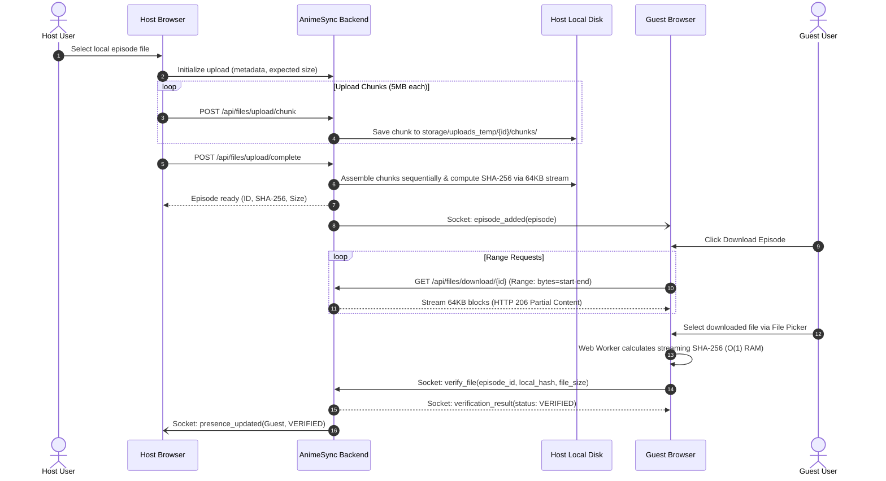
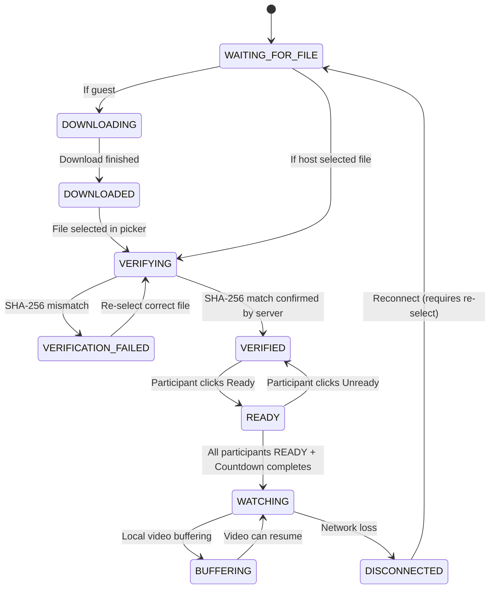
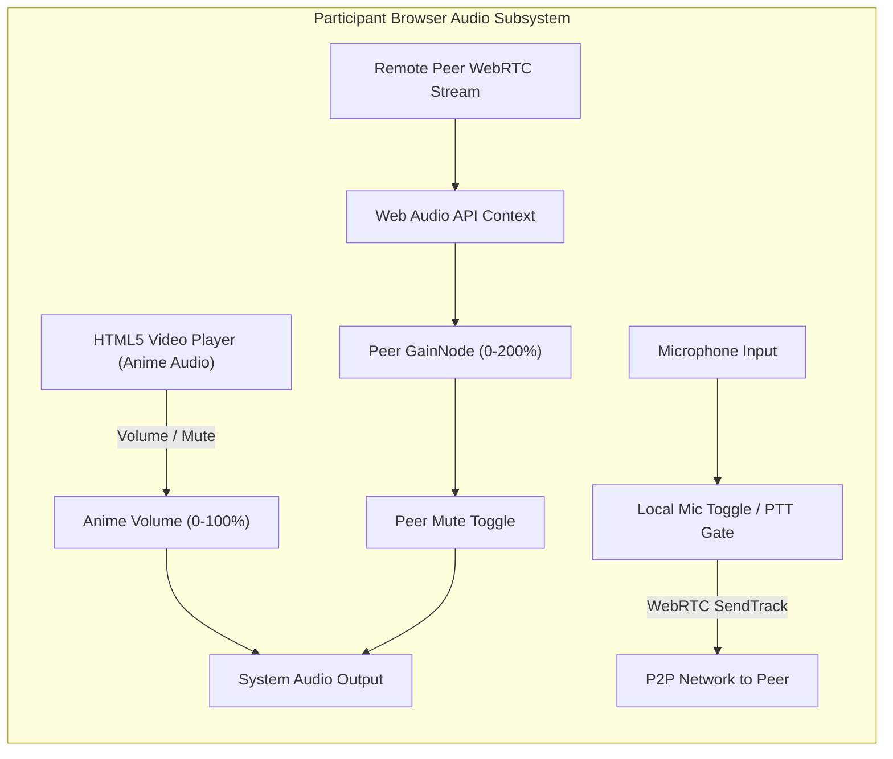

# AnimeSync — System Architecture

## 1. System Overview

AnimeSync is a private, desktop-first, online anime watch-party application designed for two participants in different homes to watch locally stored video files in exact lockstep synchronization, accompanied by real-time text chat and optional WebRTC voice chat.

```mermaid
graph TD
    subgraph HostMac ["Host Mac (Server + Participant 1)"]
        Server["FastAPI + Socket.IO (ASGI)<br/>Uvicorn :8000"]
        DB[(SQLite animesync.db)]
        Storage[("Local Video Storage<br/>storage/videos/")]
        ClientA["Browser (Host)<br/>Local File: Ep01.mp4"]
    end

    subgraph FriendHome ["Friend's Home (Participant 2)"]
        ClientB["Browser (Guest)<br/>Local File: Ep01.mp4"]
    end

    Tunnel["Free Public Tunnel / Mesh<br/>(Cloudflare Quick Tunnel / Tailscale)"]

    Server <--> DB
    Server <--> Storage
    ClientA <-->|HTTP / WebSocket| Server
    ClientB <-->|HTTP / WebSocket via Tunnel| Tunnel <--> Server
    ClientA <-.->|WebRTC P2P Audio (Google STUN)| ClientB
```

---

## 2. Architectural Pillars

### 2.1 Local Playback with Server-Authoritative Coordination
- **No live video streaming through the server during playback**: Video is NOT streamed through the server or tunnel during watch parties. Instead, both participants load the verified identical file from their local disk into their HTML5 `<video>` element.
- **Why this is critical**: Free tunnels (like Cloudflare) throttle or prohibit live high-bitrate video streaming. By distributing the file once before the watch session, network bandwidth during playback is reduced to a few tiny Socket.IO sync packets (< 1 KB/sec), ensuring zero lag, perfect 1080p/4K visual quality, and immunity to proxy limits.

### 2.2 Modular Monolith Design
- **Single ASGI Process**: FastAPI powers both the REST endpoints (chunked uploads, range-based downloads, room management) and the real-time Socket.IO event system via `socketio.ASGIApp`.
- **Embedded Static Assets**: In production/self-hosted mode, FastAPI serves the compiled Vite React frontend directly, eliminating the need for a separate reverse proxy or frontend web server.

### 2.3 Real-Time Presence & Connection Tracking
- **Multi-Tab Resilient Architecture**:
  AnimeSync separates physical WebSocket connections (`sid`) from logical participant presence. A dedicated thread-safe `ConnectionManager` maintains:
  - `_sid_to_session`: Maps each active socket ID to its authenticated `SocketSession` (room, participant, username, is_host).
  - `_participant_sockets`: Maps `(room_code, participant_id)` to a set of active socket IDs. If a user opens a second tab or refreshes their browser, both connections belong to the same logical participant.
  - Presence State: A participant is marked `is_online = True` as long as `len(sockets) > 0`. When one tab closes, the participant remains online. Only when the final socket closes does the server mark them offline and broadcast `user_left` and `presence_updated`.
- **Authoritative Room Authentication**:
  Clients can never claim room membership without providing their cryptographically generated `session_token` upon connecting or emitting `join_room`. Sockets failing database verification are immediately disconnected.
- **Strict Channel Isolation**:
  Socket broadcasts use `sio.emit(..., room=room_code)`, guaranteeing that messages and presence events are strictly isolated to authenticated members of that specific room.

---

## 3. Core Subsystems

### 3.1 Video Distribution & Verification Engine


1. **Chunked Resumable Upload**:
   - Files are split into 5MB chunks client-side using `File.slice()`.
   - Each chunk has an index verification and is saved in `storage/uploads_temp/{upload_id}/chunks/{chunk_index}.chunk`.
   - Prevents memory bloat and survives Cloudflare's 100MB body limit.
   - If network drops, the client queries `/api/files/upload/{upload_id}/status` and resumes from missing chunks.
2. **Server-Side Incremental Checksumming**:
   - During finalization, chunks are streamed sequentially into `storage/videos/{episode_id}_{safe_filename}` using 64KB read buffers.
   - Python's `hashlib.sha256()` is updated on each block, never loading the multi-gigabyte video into RAM.
   - Assembled byte count is validated against the initial declared size to prevent corrupted or truncated saves.
3. **Download with HTTP Range Support**:
   - The file download endpoint supports `Range: bytes=start-end`, enabling browser download managers to pause and resume.
   - Returns `HTTP 206 Partial Content` with `Content-Range: bytes start-end/total` and `Accept-Ranges: bytes`.
4. **Client-Side Web Worker Checksumming**:
   - Browser computes SHA-256 incrementally in a dedicated background `Worker` (`sha256.worker.ts`).
   - Uses `StreamingSHA256` in 4MB slice buffers, maintaining $O(1)$ memory.
   - Main UI thread remains 60fps responsive without stuttering or "Page Unresponsive" warnings.
   - The server validates the client's computed hash and size against the authoritative database record.

---

### 3.2 The Ready-to-Watch State Machine

Each room participant moves through a strict authoritative state machine:



**Key Invariants:**
1. Neither participant can click "Ready" unless their status is `VERIFIED`.
2. The synchronized countdown timer can ONLY be triggered by the server when all active participants are `READY`.
3. If an episode changes or the queue advances, all participants are reset to `WAITING_FOR_FILE`.

---

### 3.3 Authoritative Playback Synchronization Engine

The server tracks authoritative playback state:
- `current_timestamp`: Floating-point video time (seconds).
- `is_playing`: Boolean.
- `playback_speed`: Multiplier (0.5x to 2.0x, default 1.0x).
- `updated_at`: Server monotonic clock timestamp.
- `sequence_number`: Monotonically increasing integer.

#### Drift Correction Strategy
On each periodic sync tick (every 2 seconds) and on every playback action (play, pause, seek, speed change), the client computes its local drift:
$$\text{authoritative\_time} = \text{server\_timestamp} + (\text{is\_playing} ? (\text{now} - \text{updated\_at}) \times \text{playback\_speed} : 0)$$
$$\text{drift} = |\text{local\_video.currentTime} - \text{authoritative\_time}|$$

- **Drift < 0.25s**: Within tolerance. Do nothing.
- **0.25s $\le$ Drift < 1.5s**: Subtle rate adjustment. Temporarily alter `video.playbackRate` by $\pm 5\%$ until alignment is restored, preserving audio pitch and avoiding harsh seeking.
- **Drift $\ge$ 1.5s**: Hard seek. Immediately seek `video.currentTime` to `authoritative_time`.

#### Loop & Ping-Pong Protection
Every client command (`seek`, `play`, `pause`) includes the last known server `sequence_number`. When a client receives a server broadcast, it checks if the event originated from its own action; if so, it ignores the redundant update to prevent echoing.

---

### 3.4 Independent Audio Architecture



- **Separation**: The anime soundtrack and remote peer voice are completely separated in the browser audio pipeline.
- **Anime Audio**: Controlled directly on the HTML5 `<video>` element (`volume` and `muted`). Local-only.
- **Voice Audio**: Managed via Web Audio API `GainNode` allowing volume boost up to 200%. Muting a remote peer simply zeros out their local `GainNode` and does NOT affect their remote microphone.
- **Push-to-Talk (PTT)**: Hardware microphone track is kept enabled or gated via software `MediaStreamTrack.enabled = false` until the PTT key (`V`) is held down or toggle is activated. Manual mute always takes absolute precedence.

---

## 4. Database Schema (SQLite)

- **`rooms`**:
  - `id`: String (UUID)
  - `code`: String (6-character alphanumeric uppercase code, unique)
  - `name`: String
  - `host_id`: String
  - `is_active`: Boolean
  - `created_at`: DateTime
- **`participants`**:
  - `id`: String (UUID)
  - `room_id`: String (Foreign Key)
  - `username`: String
  - `is_host`: Boolean
  - `status`: Enum (`WAITING_FOR_FILE`, `DOWNLOADING`, `VERIFYING`, `VERIFIED`, `READY`, `WATCHING`, `DISCONNECTED`)
  - `socket_id`: String (nullable)
  - `last_seen`: DateTime
- **`episodes`**:
  - `id`: String (UUID)
  - `room_id`: String (Foreign Key)
  - `anime_title`: String
  - `season`: Integer
  - `episode_number`: Integer
  - `display_title`: String (nullable)
  - `filename`: String
  - `file_path`: String
  - `file_size_bytes`: Integer
  - `sha256_hash`: String
  - `mime_type`: String
  - `duration_seconds`: Float (nullable)
  - `upload_status`: Enum (`UPLOADING`, `COMPLETED`, `FAILED`)
  - `queue_position`: Integer
  - `created_at`: DateTime
- **`messages`**:
  - `id`: String (UUID)
  - `room_id`: String (Foreign Key)
  - `participant_id`: String (Foreign Key)
  - `username`: String
  - `content`: String
  - `created_at`: DateTime

