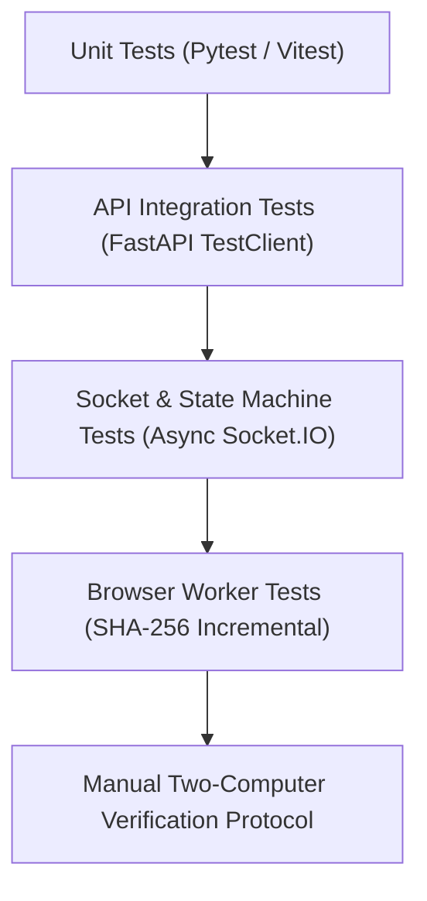

# AnimeSync — Testing Strategy & Protocol

## 1. Test Levels

AnimeSync incorporates multi-layer testing to guarantee rock-solid reliability for watch parties:

---

## 2. Automated Test Suites

### 2.1 Backend Tests (`pytest`)
Located in `backend/tests/`:
- **`test_rooms.py`**:
  - Health check endpoint and host storage disk capacity validation.
  - Room creation and unique 6-character code formatting.
  - Join room validation (username sanitization, participant token issuance).
  - Single Page Application serving verification.
- **`test_presence.py`**:
  - Two participants joining the same room: verifying both appear online in the room presence snapshot.
  - Room channel isolation: verifying that participants in Room A never receive presence updates or leak membership into Room B.
  - Unauthorized access rejection: verifying that invalid room codes, invalid session tokens, or non-existent participant IDs are immediately rejected with `ROOM_NOT_FOUND` / `AUTH_FAILED`.
  - Multi-tab and duplicate connection resilience: verifying that opening 2 tabs registers 2 active connections, closing 1 tab keeps the user online, and closing the final tab marks them offline.
  - Unexpected disconnect and reconnection: verifying that reconnecting with a fresh socket restores presence and updates `last_seen`.
  - Explicit room leave handling: verifying that `leave_room` unregisters the participant cleanly.
- **`test_upload.py`** (Phase 3):
  - Chunked upload initialization.
  - Sequential chunk saving and boundary validation.
  - File assembly and SHA-256 hash comparison between uploaded stream and raw file.
  - Prevention of path traversal attacks (`../../` filenames).
  - Resumable upload chunk index tracking.
  - Cross-room unauthorized file download prevention.
- **`test_ready_state.py`** (Phase 4):
  - `test_set_ready_rejected_when_not_verified`: WAITING_FOR_FILE status prevents participant from marking READY.
  - `test_verified_participant_transitions_to_ready`: Authoritative transition from VERIFIED to READY in DB.
  - `test_unready_reverts_ready_to_verified`: Withdrawing ready state cleanly reverts participant back to VERIFIED.
  - `test_all_online_participants_ready_logic`: Verifies that only currently connected online participants gate the countdown.
  - `test_invalidate_room_readiness`: Verifies that new episode uploads reset all participants back to WAITING_FOR_FILE while preserving active WATCHING status.
  - `test_countdown_task_cancelled`: Background countdown task is properly cancelled on unready or departure.
  - `test_socket_set_ready_rejected_if_unverified`: Socket handler emits `ready_rejected` to unverified participant.
  - `test_socket_set_ready_and_set_unready_success`: Full end-to-end socket ready and unready event lifecycles.
- **`test_sync.py`** (Phase 5 Tasks 5.2, 5.3, 5.4, 5.5 & 5.6):
  - `test_playback_manager_initial_state`: Initial state defaults (is_playing=False, current_time=0.0, playback_speed=1.0, seq=0).
  - `test_playback_manager_play_action`: PLAY action updates is_playing to True and increments sequence_number.
  - `test_playback_manager_pause_action`: PAUSE action updates is_playing to False and records position.
  - `test_playback_manager_seek_action`: SEEK action updates current_time to specified non-negative position.
  - `test_playback_manager_rate_change`: RATE_CHANGE action updates playback_speed within bounds [0.25, 4.0].
  - `test_playback_manager_invalid_actions_and_values`: Rejection of invalid action strings, negative timestamps, and out-of-bounds rates.
  - `test_playback_manager_time_progression`: Authoritative time progression calculation when playing vs static position when paused.
  - `test_socket_playback_action_unauthenticated`: Rejection of unauthenticated socket connections attempting playback actions.
  - `test_socket_playback_action_room_isolation_mismatch`: Rejection of commands with mismatched room_code (room isolation).
  - `test_socket_playback_action_readiness_gate_rejection`: Readiness gate enforcement (rejecting unverified participants).
  - `test_socket_playback_action_play_pause_seek_rate_lifecycle`: Full socket event lifecycle verifying `playback_sync` broadcast with `originating_socket_id` and monotonic sequence numbers.
  - `test_two_participants_playback_sync_and_echo_suppression`: Two-client watch party simulation verifying echo suppression via `originating_socket_id` and non-originating client application.
  - `test_cross_room_playback_isolation`: Strict channel isolation ensuring Room 1 playback broadcasts are never delivered to Room 2.
  - `test_get_playback_state_socket_handler`: Direct authoritative playback state querying via Socket.IO for client synchronization.
  - `test_authoritative_drift_formula_consistency`: Validates server authoritative elapsed time calculation matches client drift thresholds.
  - `test_playback_manager_buffering_coordination_and_recovery`: Unit test verifying shared pause on buffering and auto-resumption when all buffering participants complete.
  - `test_playback_manager_buffering_while_paused_no_autoresume`: Ensures buffering while paused does not start playback.
  - `test_playback_manager_manual_pause_overrides_buffering_resume`: Ensures explicit manual pause cancels automatic buffering resumption.
  - `test_socket_buffering_start_and_end_lifecycle`: Full socket event integration for `buffering_start` and `buffering_end`.
  - `test_socket_buffering_multiple_participants_coordination`: Multi-participant buffering coordination verifying playback stays paused until the last buffering participant finishes.
  - `test_socket_buffering_disconnect_recovery`: Verifies that if a buffering participant disconnects, remaining viewers resume automatically.
  - `test_socket_buffering_unverified_rejected`: Verifies unverified participants cannot trigger buffering events.
  - `test_ping_check_latency_measurement` (Task 5.6): Round-trip ping echo validation returning client timestamp and server time.
  - `test_manual_resync_alignment_playing` (Task 5.6): Authoritative playback state alignment when playing, calculating elapsed server time.
  - `test_manual_resync_alignment_paused` (Task 5.6): Authoritative playback state alignment when paused, retaining static position.
  - `test_manual_resync_alignment_buffering_preservation` (Task 5.6): Authoritative state retrieval preserving `paused_for_buffering` status during manual resync.

### 2.2 Frontend Unit Tests (`node --test`)
Located in `frontend/tests/`:
- **`drift.test.ts`** (20 unit tests):
  - `computeAuthoritativeTime`: verifies static time when paused, linear time advancement at 1.0x, custom playback speeds (1.5x), and monotonic `localReceivedAt` handling.
  - `computeDrift`: signed drift measurement (negative when local is behind, positive when ahead, zero when in sync).
  - `evaluateDriftCorrection`:
    - Tolerance zone ($|\text{drift}| < 0.25$s): returns `NONE` when unadjusted, or `RESTORE_RATE` to restore user's intended speed.
    - Micro-drift zone ($0.25\text{s} \le |\text{drift}| < 1.5$s): tests `NUDGE_FASTER` ($+5\%$) when behind and `NUDGE_SLOWER` ($-5\%$) when ahead across default and custom intended speeds.
    - Macro-drift zone ($|\text{drift}| \ge 1.5$s): tests `HARD_SEEK` directly to authoritative timestamp and restores intended rate.
    - Exact threshold boundaries: verifies 0.25s triggers micro-adjustment and 1.5s triggers hard seek.
    - Paused state handling: tests that paused playback (server or local) inhibits drift adjustments and resets active nudges.
    - Null snapshot safety: graceful `NONE` fallback.
- **`sync_health.test.ts`** (10 unit tests, Task 5.6):
  - `determineSyncStatus`: validates statuses across room buffering, local buffering, active nudging, paused playback, and nominal synchronized playback.
  - `computePingLatency`: validates round-trip ping time calculation and negative clock-skew clamping.
  - `calculateResyncTarget`: verifies target timestamp calculation with elapsed time at 1.0x, custom rates (1.5x), and static timestamp preservation while paused.

---

## 3. Two-Computer Validation Protocol (Acceptance Testing)

Before declaring any release ready, execute this manual protocol across two independent computers on separate Wi-Fi networks:

| Step | Action | Expected Result | Pass/Fail |
| :--- | :--- | :--- | :--- |
| **1** | Host starts server and launches tunnel (`./scripts/start.sh`) | Terminal outputs local URL and public HTTPS tunnel URL. | [ ] |
| **2** | Host creates room "Demon Slayer Night" | Host enters room lobby with 6-character code generated. | [ ] |
| **3** | Friend navigates to public tunnel URL and joins with room code | Friend appears instantly in Host's participant list via Socket.IO. | [ ] |
| **4** | Host uploads a test MP4 video file | Chunked progress displays 0% $\rightarrow$ 100%. Server computes SHA-256. | [ ] |
| **5** | Friend clicks "Download Episode" | Download begins via range-request stream and completes to Friend's Mac. | [ ] |
| **6** | Friend selects the downloaded file in file picker | Web Worker computes SHA-256; server validates matching hash $\rightarrow$ status `VERIFIED`. | [ ] |
| **7** | Friend tests selecting a DIFFERENT file | Verification fails; clear error displayed; "Ready" button remains disabled. | [ ] |
| **8** | Both participants click "Ready" | Server triggers 3-second synchronized countdown. | [ ] |
| **9** | Playback starts simultaneously | Video begins at 00:00 on both screens. Sync health shows green "Synced". | [ ] |
| **10**| Host pauses video at 02:15 | Friend's video pauses immediately at 02:15. | [ ] |
| **11**| Friend seeks to 05:40 | Host's video seeks immediately to 05:40. | [ ] |
| **12**| Host changes playback speed to 1.25x | Friend's playback speed synchronizes to 1.25x. | [ ] |
| **13**| Test Text Chat | Messages sent appear instantaneously on both screens in chronological order. | [ ] |
| **14**| Both join Voice Chat | Audio connection establishes via Google STUN; speaking rings activate. | [ ] |
| **15**| Test Push-to-Talk (`V`) | Audio transmits only while holding `V`; muting is instant on keyup. | [ ] |
| **16**| Test Independent Audio | Adjusting anime volume has zero effect on peer voice volume. | [ ] |
| **17**| Test Sidebar Collapse | Clicking arrow collapses chat/participant sidebar; video expands smoothly. | [ ] |
| **18**| Test Fullscreen Mode | Pressing `F` hides all UI elements; mouse movement shows controls; Escape exits. | [ ] |

