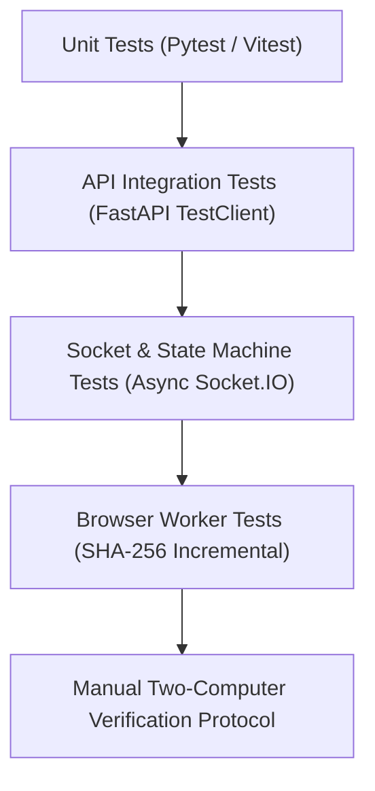

# AnimeSync — Testing Strategy & Protocol

## 1. Test Levels

AnimeSync incorporates multi-layer testing to guarantee rock-solid reliability for watch parties:

---

## 2. Automated Test Suites

### 2.1 Backend Tests (`pytest`)
Located in `backend/tests/`:
- **`test_rooms.py`**:
  - Room creation and unique 6-character code formatting.
  - Join room validation (username sanitation, participant limits).
  - Session authorization token verification.
- **`test_upload.py`**:
  - Chunked upload initialization.
  - Sequential chunk saving and boundary validation.
  - File assembly and SHA-256 hash comparison between uploaded stream and raw file.
  - Prevention of path traversal attacks (`../../` filenames).
  - Resumable upload chunk index tracking.
- **`test_sync.py`**:
  - Server-authoritative playback state transitions (play, pause, seek, speed).
  - Monotonic sequence number generation.
  - Originating socket filtering (avoiding client self-echo loops).
  - Ready-to-watch gate enforcement (rejecting ready state before verification).

### 2.2 Frontend Tests (`vitest`)
Located in `frontend/src/__tests__/`:
- **File Hasher Worker**: Incremental hashing of chunked Blob objects matches known SHA-256 digests.
- **Sync Engine Hook**: Drift calculation and playback rate adjustment thresholds.
- **Independent Audio Controller**: Verifying that changing anime volume does not modify Web Audio GainNode.

---

## 3. Two-Computer Validation Protocol (Acceptance Testing)

Before declaring any release ready, execute this manual protocol across two independent computers on separate Wi-Fi networks:

| Step | Action | Expected Result | Pass/Fail |
| :--- | :--- | :--- | :--- |
| **1** | Host starts server and launches tunnel (`./scripts/start.sh`) | Terminal outputs local URL and public HTTPS tunnel URL. | [ ] |
| **2** | Host creates room "Demon Slayer Night" | Host enters room lobby with 6-character code generated. | [ ] |
| **3** | Friend navigates to public tunnel URL and joins with room code | Friend appears instantly in Host's participant list via Socket.IO. | [ ] |
| **4** | Host uploads a test MP4 video file | Chunked progress displays 0% $\rightarrow$ 100%. Server computes SHA-256. | [ ] |
| **5** | Friend clicks "Download Episode" | Download begins via range-request stream and completes to Friend's Mac. | [ ] |
| **6** | Friend selects the downloaded file in file picker | Web Worker computes SHA-256; server validates matching hash $\rightarrow$ status `VERIFIED`. | [ ] |
| **7** | Friend tests selecting a DIFFERENT file | Verification fails; clear error displayed; "Ready" button remains disabled. | [ ] |
| **8** | Both participants click "Ready" | Server triggers 3-second synchronized countdown. | [ ] |
| **9** | Playback starts simultaneously | Video begins at 00:00 on both screens. Sync health shows green "Synced". | [ ] |
| **10**| Host pauses video at 02:15 | Friend's video pauses immediately at 02:15. | [ ] |
| **11**| Friend seeks to 05:40 | Host's video seeks immediately to 05:40. | [ ] |
| **12**| Host changes playback speed to 1.25x | Friend's playback speed synchronizes to 1.25x. | [ ] |
| **13**| Test Text Chat | Messages sent appear instantaneously on both screens in chronological order. | [ ] |
| **14**| Both join Voice Chat | Audio connection establishes via Google STUN; speaking rings activate. | [ ] |
| **15**| Test Push-to-Talk (`V`) | Audio transmits only while holding `V`; muting is instant on keyup. | [ ] |
| **16**| Test Independent Audio | Adjusting anime volume has zero effect on peer voice volume. | [ ] |
| **17**| Test Sidebar Collapse | Clicking arrow collapses chat/participant sidebar; video expands smoothly. | [ ] |
| **18**| Test Fullscreen Mode | Pressing `F` hides all UI elements; mouse movement shows controls; Escape exits. | [ ] |
